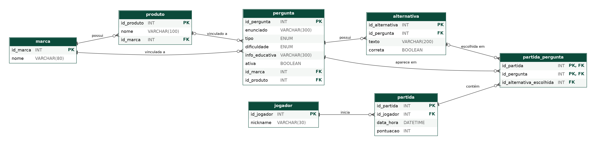

# Banco de Dados – ARCOR: Desafio das Marcas

Documentação da **modelagem física** do banco de dados do projeto interdisciplinar (1º ADS – 2º semestre de 2026), elaborada a partir do modelo conceitual (DER) da Entrega 1.

**Entrega 2 – Fundamentos de Banco de Dados:** modelagem física de tabelas (7 tabelas criadas em MySQL, documentadas neste arquivo).

- **SGBD:** MySQL
- **Banco:** `desafio_marcas`
- **Script de criação:** [`criacao_tabelas.sql`](./criacao_tabelas.sql)

---

## 1. Modelo conceitual (DER)

> Inserir aqui a imagem do DER exportada do draw.io.
>
> ``

### Ajustes feitos do modelo conceitual para o físico

| Ajuste | Motivo |
|---|---|
| `Jogador` passou a ter apenas `nickname` (sem e-mail e senha) | O briefing pede coleta mínima de dados pessoais |
| `correto` e `incorreto` viraram um único campo `correta` em `alternativa` | Eram redundantes |
| Criada a tabela associativa `partida_pergunta` | A relação partida × pergunta é N:N |
| Vínculo com marca/produto movido para `pergunta` | O briefing exige que toda pergunta tenha vínculo com marca/linha/produto |
| `resultado` incorporado em `partida` (`pontuacao`) | Evita duplicar a pontuação |
| Adicionados `tipo`, `info_educativa` e `ativa` em `pergunta` | Requisitos do briefing: tipo da pergunta, feedback educativo e inativação de conteúdo |

---

## 2. Modelo físico (diagrama)



---

## 3. Relacionamentos

| Relacionamento | Cardinalidade | Implementação |
|---|---|---|
| marca → produto | 1:N | `produto.id_marca` (FK) |
| marca → pergunta | 1:N | `pergunta.id_marca` (FK) |
| produto → pergunta | 1:N (opcional) | `pergunta.id_produto` (FK, aceita NULL) |
| pergunta → alternativa | 1:N | `alternativa.id_pergunta` (FK) |
| jogador → partida | 1:N | `partida.id_jogador` (FK) |
| partida ↔ pergunta | N:N | tabela `partida_pergunta` |
| alternativa → partida_pergunta | 1:N (opcional) | `partida_pergunta.id_alternativa_escolhida` (FK) |

---

## 4. Dicionário de dados

### 4.1 `marca`

| Campo | Tipo | Restrição | Descrição |
|---|---|---|---|
| id_marca | INT | PK, AUTO_INCREMENT | Identificador da marca |
| nome | VARCHAR(80) | NOT NULL, UNIQUE | Nome da marca |

### 4.2 `produto`

| Campo | Tipo | Restrição | Descrição |
|---|---|---|---|
| id_produto | INT | PK, AUTO_INCREMENT | Identificador do produto |
| nome | VARCHAR(100) | NOT NULL | Nome do produto |
| id_marca | INT | NOT NULL, FK → marca | Marca à qual o produto pertence |

### 4.3 `pergunta`

| Campo | Tipo | Restrição | Descrição |
|---|---|---|---|
| id_pergunta | INT | PK, AUTO_INCREMENT | Identificador da pergunta |
| enunciado | VARCHAR(300) | NOT NULL | Texto da pergunta |
| tipo | ENUM('multipla_escolha','verdadeiro_falso') | NOT NULL | Tipo da pergunta |
| dificuldade | ENUM('facil','medio','dificil') | NOT NULL | Nível de dificuldade |
| info_educativa | VARCHAR(300) | NULL | Informação exibida no feedback após a resposta |
| ativa | BOOLEAN | NOT NULL, DEFAULT TRUE | Permite inativar a pergunta sem apagá-la |
| id_marca | INT | NOT NULL, FK → marca | Marca relacionada |
| id_produto | INT | NULL, FK → produto | Produto relacionado (opcional) |

### 4.4 `alternativa`

| Campo | Tipo | Restrição | Descrição |
|---|---|---|---|
| id_alternativa | INT | PK, AUTO_INCREMENT | Identificador da alternativa |
| id_pergunta | INT | NOT NULL, FK → pergunta | Pergunta à qual pertence |
| texto | VARCHAR(200) | NOT NULL | Texto da alternativa |
| correta | BOOLEAN | NOT NULL, DEFAULT FALSE | Indica se é a alternativa correta |

### 4.5 `jogador`

| Campo | Tipo | Restrição | Descrição |
|---|---|---|---|
| id_jogador | INT | PK, AUTO_INCREMENT | Identificador do jogador |
| nickname | VARCHAR(30) | NOT NULL | Apelido do jogador |

### 4.6 `partida`

| Campo | Tipo | Restrição | Descrição |
|---|---|---|---|
| id_partida | INT | PK, AUTO_INCREMENT | Identificador da partida |
| id_jogador | INT | NOT NULL, FK → jogador | Jogador que iniciou a partida |
| data_hora | DATETIME | NOT NULL, DEFAULT CURRENT_TIMESTAMP | Data e hora de início |
| pontuacao | INT | NOT NULL, DEFAULT 0 | Pontuação final da partida |

### 4.7 `partida_pergunta`

| Campo | Tipo | Restrição | Descrição |
|---|---|---|---|
| id_partida | INT | PK (composta), FK → partida | Partida |
| id_pergunta | INT | PK (composta), FK → pergunta | Pergunta apresentada na partida |
| id_alternativa_escolhida | INT | NULL, FK → alternativa | Alternativa escolhida pelo jogador |

---

## 5. Script SQL de criação

```sql
CREATE DATABASE IF NOT EXISTS desafio_marcas;
USE desafio_marcas;

CREATE TABLE marca (
  id_marca INT AUTO_INCREMENT PRIMARY KEY,
  nome VARCHAR(80) NOT NULL UNIQUE
);

CREATE TABLE produto (
  id_produto INT AUTO_INCREMENT PRIMARY KEY,
  nome VARCHAR(100) NOT NULL,
  id_marca INT NOT NULL,
  FOREIGN KEY (id_marca) REFERENCES marca(id_marca)
);

CREATE TABLE pergunta (
  id_pergunta INT AUTO_INCREMENT PRIMARY KEY,
  enunciado VARCHAR(300) NOT NULL,
  tipo ENUM('multipla_escolha','verdadeiro_falso') NOT NULL,
  dificuldade ENUM('facil','medio','dificil') NOT NULL,
  info_educativa VARCHAR(300),
  ativa BOOLEAN NOT NULL DEFAULT TRUE,
  id_marca INT NOT NULL,
  id_produto INT NULL,
  FOREIGN KEY (id_marca) REFERENCES marca(id_marca),
  FOREIGN KEY (id_produto) REFERENCES produto(id_produto)
);

CREATE TABLE alternativa (
  id_alternativa INT AUTO_INCREMENT PRIMARY KEY,
  id_pergunta INT NOT NULL,
  texto VARCHAR(200) NOT NULL,
  correta BOOLEAN NOT NULL DEFAULT FALSE,
  FOREIGN KEY (id_pergunta) REFERENCES pergunta(id_pergunta)
);

CREATE TABLE jogador (
  id_jogador INT AUTO_INCREMENT PRIMARY KEY,
  nickname VARCHAR(30) NOT NULL
);

CREATE TABLE partida (
  id_partida INT AUTO_INCREMENT PRIMARY KEY,
  id_jogador INT NOT NULL,
  data_hora DATETIME NOT NULL DEFAULT CURRENT_TIMESTAMP,
  pontuacao INT NOT NULL DEFAULT 0,
  FOREIGN KEY (id_jogador) REFERENCES jogador(id_jogador)
);

CREATE TABLE partida_pergunta (
  id_partida INT NOT NULL,
  id_pergunta INT NOT NULL,
  id_alternativa_escolhida INT NULL,
  PRIMARY KEY (id_partida, id_pergunta),
  FOREIGN KEY (id_partida) REFERENCES partida(id_partida),
  FOREIGN KEY (id_pergunta) REFERENCES pergunta(id_pergunta),
  FOREIGN KEY (id_alternativa_escolhida) REFERENCES alternativa(id_alternativa)
);
```

### Carga inicial de exemplo

```sql
INSERT INTO marca (nome) VALUES ('Tortuguita'), ('Triunfo');
```

> As perguntas, alternativas e informações educativas devem ser cadastradas com base em fontes oficiais da Arcor, conforme o briefing do projeto.

[← Voltar ao README principal](../README.md)
